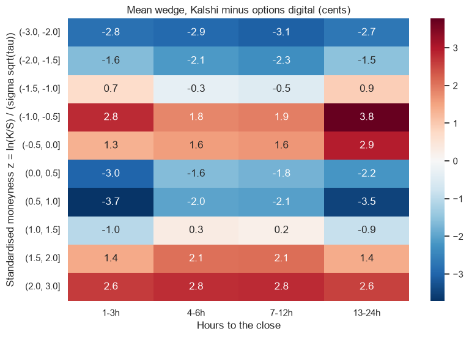
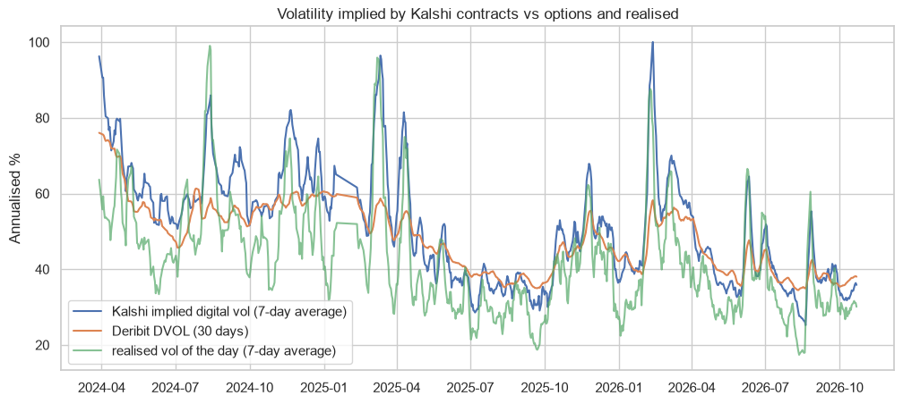

# Two markets for the same state price: Kalshi Bitcoin contracts vs the option-implied digital

Part of my Graduating Project at Rennes School of Business. A Kalshi contract "Bitcoin above K at 5 pm" pays 1 dollar in one state of the world, so it is a digital option. The options market has a price for the same digital: N(d2) in Black-Scholes, or the slope of the calls across strikes (Breeden-Litzenberger). The difference between the two prices (the **wedge**) is the basis risk of a note that is hedged in one market and pays in the other.

The panel has 245.000 hourly quotes of 19.000 Kalshi contracts (840 days, March 2024 to October 2026). Each quote is compared with N(d2), using Deribit DVOL and the Binance spot of the same hour.

**Data:**
- Kalshi public API: KXBTCD markets and hourly bid/ask.
- Deribit: DVOL, hourly.
- Binance: BTCUSDT, hourly.

## Results
- **The markets agree on average, but not strike by strike.**
  - The mean wedge is zero, but the mean absolute wedge is 3.5 cents, more than the Kalshi half spread (around 2 cents).
  - The options digital is inside the Kalshi bid-ask only in 41% of the quotes.
- **The wedge has an S shape.** Compared with a normal distribution at the 30-day volatility, Kalshi gives more probability to small moves (a narrow centre) and to big moves (fat tails).
- **The volatility implied by the Kalshi ladder is a smile:** around 38% near the money and 55% in the tails, while DVOL is around 43%.

| Forecast of the realised volatility of the next day | Slope | R2 |
|---|---|---|
| Kalshi implied digital volatility | 0.89 | 0.61 |
| Deribit DVOL (30 days) | 1.20 | 0.27 |

- **Kalshi knows more about tomorrow's volatility than DVOL.** With both variables in the regression, DVOL adds nothing.
- **Kalshi is at least as good a probability as the options digital.** Its Brier score is lower than N(d2) with DVOL at every horizon from 1 to 24 hours.
- **Basis risk in dollars:** for a 1.000 dollar digital coupon near the money, 6 hours before the close:
  - the two prices differ by 59 dollars (standard deviation);
  - in 10% of the days they differ by more than 100 dollars.




## How to run
```
pip install -r requirements.txt
python collect_kalshi_btc.py      # Kalshi, Binance and Deribit data (already saved in data/kalshi_btc)
jupyter notebook btc_wedge.ipynb
```

---
Alejandro Lezcano Osorio | Rennes School of Business (MSc in Financial Data Intelligence) and Universidad EIA
